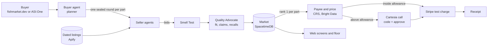

<div align="center">

# Fish Market

### The agentic marketplace where buyers and sellers thrive.

Nothing fishy gets through.

**[fishmarket.dev](https://fishmarket.dev)**

<p>
  
  
  
  
  
  
</p>

[How it works](#how-it-works) · [Real and simulated](#whats-real-and-whats-simulated) · [Results](#measured-results) · [Sponsors](#sponsor-integrations) · [Agents](#fetchai-agents) · [Getting started](#getting-started) · [Architecture](docs/ARCHITECTURE.md)

</div>

<!-- VIDEO: walkthrough -->

<!-- IMG: floor -->

## Overview

Fish Market is a marketplace where your AI buyer agent shops for PC parts and seller agents compete for the order in sealed rounds. Before any money moves, Smell Test screens every listing for hidden instructions, a checker confirms each part fits your build and is not recalled, and the winning price is re-checked live. Inside the allowance you set, the agent pays on its own; above it, nothing is paid until you approve on a phone call with a code that only your screen shows.

## How it works

1. **You state a goal.** "A 1440p gaming PC under $2,100." The planner turns it into parts and skips the ones you already own (`agents/buyer/planner.py`).
2. **One sealed knockout round per part.** Seller agents bid without seeing your exact budget (they get a $500 band), your allowance or each other's offers. A round runs up to three best-and-final stages. Rule-breakers and last place are knocked out with a reason; survivors only hear "still in." When two picks clash, the agent re-plans that part once (`demo/build.py`, `market/spacetimedb/`).
3. **Smell Test screens every bid.** Each seller message, listing title and claim is screened before any agent reads it. A listing that hides instructions or swaps the payee is quarantined with the rules that fired (`shield/`).
4. **The checker tests fit and recalls.** The Quality Advocate checks socket, memory type, power, connectors and clearance by code, compares the seller's claim with its page, and looks up CPSC recalls. It can veto the cheapest bid, and every warning cites its source (`agents/advocate/`, `data/fit_checker/`, `data/recalls.py`).
5. **The referee ranks.** One deterministic rule in the market's reducers ranks the offers. The same offers always rank the same way, no bid lands below its seller's floor, and the seller fee never enters the ranking (`market/rules/`, [docs/ARENA_RULES.md](docs/ARENA_RULES.md)).
6. **CRS checks the payee.** A business seller needs a fresh, verified CRS identity check before it can be paid, and the check is bound into the payment mandate (`pay/crs_gate.py`, `agents/crs.py`).
7. **Bright Data re-checks the price live.** Right before the call, each winning listing's price is read again from the store. A price that moved or a part that sold out stops the build (`demo/recheck.py`, `data/baselines/brightdata.py`).
8. **Above your allowance, you approve by phone.** A Cartesia voice agent calls you, reads the build and its total, and answers "why not the cheaper one?" Code, not the voice agent, decides: only the one-time code on your screen plus "approve" passes. Silence, a hang-up or a wrong code denies, and nothing is paid (`pay/voice_cartesia.py`, `pay/approval.py`).
9. **Stripe test charge.** With `--stripe`, each part is charged once in Stripe test mode, keyed to its mandate so a retry cannot charge twice; without it, a labelled SIM stub stands in. No real money moves (`demo/approval_flow.py`).
10. **Receipt.** You get a receipt for every part with the charge reference and the mandate.

Losing sellers get a loss report: a banded gap and the reason with its source, never a rival's price or your budget. A seller agent can adjust its next bid, never below its floor.

<!-- IMG: buyer -->

## Key capabilities

- **A skeptic on the buyer's side.** The Quality Advocate is deterministic code, not a model. It can veto the cheapest bid and must cite a source for every warning.
- **Fit checking you can audit.** Rules over an open parts dataset plus maker specs. An unknown fit is "uncertain" and can never beat a confirmed fit.
- **Smell Test, agent security as an API.** `POST /v1/shield/screen`, `/verify-agent` and `/verify-mandate`, plus a claim check, with a published rule list ([shield/API.md](shield/API.md)). It fails closed: an unset URL, a timeout or an error blocks.
- **Sealed knockout rounds in a shared market.** Rounds, floors, rankings, mandates and approvals live in SpacetimeDB reducers, so every screen and agent sees the same state, and payment needs a recorded approval.
- **Voice is the trust step, never the credential.** The code on your screen is single use and bound to one mandate (amount, payee, expiry). A recording of your voice cannot approve a payment.
- **Scoped, replay-proof mandates.** Each mandate binds deal, amount, payee, expiry and nonce, and only the market's real winner gets one.
- **Seller tools.** The Seller Kit turns a shop's prices, perks and floors into a seller agent config, and screens the shop's listing text with Smell Test before anything is saved ([seller_kit/](seller_kit/)).
- **IT purchasing controls.** PO numbers, a requester who cannot approve their own order, three-way match and an audit trail ([hyphenate/](hyphenate/)).

## What's real and what's simulated

Every bid, claim and screen carries a label driven by the `source` field in the contracts: LIVE (a real outside party, now), MIRROR (a real, dated copy), SIM (generated by us), SANDBOX (a vendor's test mode). Status as of Sun Oct 25, 2026, 02:00 PDT, on `main`.

| Component | Label | Notes |
|---|---|---|
| Store listings and prices | MIRROR | Real public listings from Best Buy, Micro Center, B&H, Amazon and eBay in dated snapshots, collected with Apify ([data/mirror/](data/mirror/)) |
| Seller agents and their bids | SIM | Our agents bid from the mirrored listings. Central Comp MIRROR bids a real San Francisco store's listings for comparison; that store is not a partner and is never paid. No outside shop has bid yet |
| Sign-up and goals on fishmarket.dev | LIVE | A person creates a buyer account and posts a goal, stored under their own account in the market |
| Full build (knockout rounds, re-plan, one call) | LIVE code | Runs in the build runner (`demo/build.py`) against the shared market. A goal posted on the website runs one part in one sealed round through the buyer agent |
| Smell Test | LIVE code | Rules on every message. The Claude classifier is opt-in (`SHIELD_CLASSIFIER=1`) |
| Fit and recall checks | LIVE code | Fit over a dated open dataset plus maker specs; recalls from the CPSC public API, cached per brand for 24 hours |
| Claim checks | LIVE code | On real listings it has found no false claims so far; the condition lie in the demo is on a page we host (SIM) |
| Bright Data re-check | built, env-gated | Runs when `BRIGHT_DATA_API_KEY` is set; without it, the dated MIRROR price stays and the line says so |
| CRS payee check | SANDBOX, env-gated | CRS sandbox with provided test identities. Run live on Oct 24 at 16:37 PDT: two simulated sellers came back verified_stable, one not_verified |
| Approval call | LIVE | A real Cartesia outbound call to the buyer's own phone from sign-up. Calls ring only numbers on `APPROVAL_CALL_ALLOWLIST` when it is set, at most 1 per number per 5 minutes and 20 per day (`pay/voice_cartesia.py`, [#451](https://github.com/vs-githjk/cal-hacks-2026/pull/451)) |
| Payment | SANDBOX | Stripe test mode only; every charging path refuses anything but an `sk_test_` key |
| Request signing (Visa TAP) | LIVE code | Visa's Trusted Agent Protocol wire format (RFC 9421, Ed25519, nonce), verified against a port of Visa's reference verifier ([#387](https://github.com/vs-githjk/cal-hacks-2026/pull/387)). Used in the reference run and chat checkout. Not certified by Visa |
| Receipts | LIVE | In the build runner and in chat. The emailed receipt goes through ASI:One's Gmail connector from the buyer's own account, tested once live |
| Price history (Tiger Data) | built, env-gated | Each round's bid prices are written when the service is set, never on the money path |
| Market state (SpacetimeDB) | LIVE | Maincloud, database `tech-bazaar` |
| Wind tunnel buyers | SIM | Simulated by design |

**Known limits, stated once.**
- The website's purchase step is being fixed: a goal posted on fishmarket.dev reaches a winner but not yet the call ([#447](https://github.com/vs-githjk/cal-hacks-2026/pull/447)). The full flow above runs through the build runner today.
- The website path does not yet run the CRS payee gate, TAP signing or the Smell Test payment receipt at charge time. The build runner runs CRS; TAP runs in the reference run and chat checkout.
- Phone verification for new sign-ups is on the fix list ([#449](https://github.com/vs-githjk/cal-hacks-2026/issues/449)). Call limits are in ([#451](https://github.com/vs-githjk/cal-hacks-2026/pull/451)); a blank `APPROVAL_CALL_ALLOWLIST` means no allowlist, only the rate cap.
- Speech-to-text can miss the code in a noisy room. The answer is a new code, never a looser match.

Full component table: [docs/REAL_VS_SIMULATED.md](docs/REAL_VS_SIMULATED.md).

## Measured results

Every number below comes from a command in this repo. Headlines are first runs; anything fixed after reading a result is marked not blind.

| Measure | Result | Reproduce |
|---|---|---|
| Smell Test, held-out attacks (rules only, rerun 2026-10-25) | 13 of 20 stopped (65%); 2 of 10 honest listings wrongly blocked (20%) | `python3 -m shield.bench` |
| Fit checker (rerun 2026-10-25) | 39 of 39 right on builds whose every part was checked on a maker page; 48 of 49 decided on all 50 builds, 1 uncertain; 0 false OK. Tuned once, so not held out | `python3 -m data.fit_checker.eval_builds` |
| Voice approval attacks | 9 of 10 denied on the first run; 10 of 10 after one fix (not blind). The suite passes, 68 tests | `python3 -m pytest pay/tests/test_voice_attacks.py -q` |
| Purchasing controls, blind planted errors | 26 of 27 caught on the first run; 2 of 7 clean cases falsely flagged | `python3 -m hyphenate.scenarios.blind_run` |
| Seller learning lift (rerun 2026-10-25 09:17 UTC) | No headline lift: the learner beats the field-median control on 0 of 4 held-out archetypes; the gate needs 2. The same command printed 1 of 4 on 2026-10-24 (`sff_open_box`) | `python3 -m sim.wind_tunnel --builders 48 --seeds 3` (the 2026-10-24 run is saved in `sim/RESULTS-2026-10-24-b48x3.md`; the 2026-10-25 run in `sim/out/wind_tunnel-2026-10-25-b48x3.json`) |
| Verified savings | None yet. The price reference is ready (median $1,279.99 for an RTX 5070 Ti across 8 in-stock retail asks from 2 providers), but no verified purchase is recorded | `python3 -m data.baselines` |

Smell Test stops 30 of 30 on its development set, but its rules were written against that set, so we never pool it with the held-out result and never call it "secure." The wind tunnel writes `sim/RESULTS-<date>-b48x3.md`; the published scoreboard is [data/scoreboard.json](data/scoreboard.json). Its seller learning tile reads the largest saved run, 48 builders by 5 seeds on 2026-10-24, which found 1 of 4; it has not been rebuilt from the 2026-10-25 run.

## Sponsor integrations

| Sponsor | What we use | Where | Status |
|---|---|---|---|
| Fetch.ai | uAgents, Agentverse, ASI:One, Agent Chat Protocol, ASI:One Gmail connector | `agents/` | LIVE: five agents registered on Agentverse, plus one retired seller profile (profiles checked Oct 23, [agents/README.md](agents/README.md)) |
| Cartesia | Voice agent, outbound calls, dynamic variables, call transcripts | `pay/voice_cartesia.py` | LIVE |
| Apify | Store Actors for listing mirrors, plus five Actors of our own | `data/mirror/`, `data/*actor*` | LIVE: four public on the Store, one private |
| Bright Data | Scraper API, the live price re-check before the call | `demo/recheck.py`, `data/baselines/brightdata.py` | built, env-gated |
| CRS | Identity check of the payee at the payment gate | `agents/crs.py`, `pay/crs_gate.py` | SANDBOX |
| Stripe | Test mode charges, idempotent on the mandate hash | `demo/approval_flow.py` | SANDBOX |
| SpacetimeDB | Reducers and live state for rounds, floors, mandates and approvals | `market/spacetimedb/` | LIVE on Maincloud |
| Tiger Data | Time-series Postgres for bid prices and Market Pulse trends | `data/tiger/` | built, env-gated |
| Visa | Trusted Agent Protocol wire format; the Visa test card behind the Stripe charge | `pay/tap.py` | LIVE code, not certified |
| Anthropic | Claude Haiku 5.5 as an opt-in Smell Test classifier; it never decides money | `shield/classifier.py` | opt-in |
| Vercel | Hosting for the web app | `web/` | LIVE |

Public data: the CPSC recalls API and [docyx/pc-part-dataset](https://github.com/docyx/pc-part-dataset) (MIT) for compatibility fields.

## Fetch.ai agents

<!-- VIDEO: fetch -->

| Agent | Job | ASI:One handle | Agentverse address | Status |
|---|---|---|---|---|
| Fish Market Buyer | Takes goals in ASI:One, remembers owned parts, runs the sealed round, asks for approval before any payment | @techbazaarbuyer | `agent1qwxhy93uzmw5prlqldm8a2mz9gsmc2563um6th2l6z0pudw63juej97nmj8` | Registered |
| Fish Market Quality Advocate | Checks fit, claims and recalls; at most 3 cited warnings; can veto the cheapest bid; never sees the fee | @techbazaaradvocate | `agent1qvxvlletez0ywdcq7da76ufzz4lvh5xvtd4fxam22g6phqzr07kvjcmhv05` | Registered |
| Fish Market Smell Test | Chat front door to Smell Test screening; makes no purchases | @techbazaarshield | `agent1q0m2z43cf3hg4cfy87hatf69ulyqkvuylm6mjv53e6y05weqmhjj6k4lknp` | Registered |
| Byte Bros Outlet | Seller that learns: a loss report's gap becomes a price step, never below its floor | @techbazaarseller1 | `agent1qd3gvg54tsaezed0wzpgg34rza4y6kvvfd778nj6h27j20k99d38zd3et9m` | Registered |
| FlashDeal Frankie | Seller that lies: its bid says new, its page says open box, and the Advocate vetoes it (SIM, planted) | @techbazaarseller3 | `agent1qdcrmqy2ra2tvshq2qhc8q5rvqzpr7du77st32qynwazy48gtuvyspdm26l` | Registered |
| ReNew Refurb | Seller that bundles refurbished and open-box lines, with the condition on every line | @techbazaarseller5 | assigned when registered | Runs locally |
| Central Comp MIRROR | Bids a real San Francisco store's dated listings for comparison; never ordered or paid | none | assigned when registered | Runs locally |
| Fish Market Caller | Places the one approval call for a mandate; approves and charges nothing itself | @techbazaarcaller | assigned when registered | Runs locally |
| Market Pulse | Answers price-trend and seller-record questions from Tiger Data, the CRS cache and finished rounds | @techbazaarpulse | assigned when registered | Runs locally |

At most four Fetch.ai seller agents run (Byte Bros Outlet, FlashDeal Frankie, ReNew Refurb and Central Comp MIRROR), each with one distinct job. Two sellers are retired and not run (`RETIRED_SELLERS` in `agents/common.py`): Silicon Sally's Surplus (seller_2) and Bay Area PC Shop (seller_4). Sally's old profile (@techbazaarseller2, `agent1qw9dvuwgnh570wyk8uukp0w48a03tdpmtuv8csm3qxy6t3udl3ahs2264np`) was registered on Agentverse and may still be listed there; it is not a working seller. Bay Area was never registered. The buyer includes the Payment Protocol, but a payment request in chat is refused on purpose: above the allowance, money moves only after the phone approval. The handles, the `tech-bazaar` database and one Actor URL keep the project's original name because they are live identifiers. Setup and profile checks: [agents/README.md](agents/README.md).

<!-- VIDEO: cartesia -->

## Apify Actors

Five Actors, each doing one job in our process. The product runs the same code in process; the Actors are how outside agents and developers reach it. No outside users yet.

| Actor | Job | Actor ID | Store | Pricing (pay per event) |
|---|---|---|---|---|
| PC Build Compatibility Checker | 12 fit rules over a build, with the maker page behind each number | `djo1yhWs81xud1DkO` | [public](https://apify.com/anoopibrampur/pc-build-compatibility-checker) | $0.005 per build checked |
| Listing Claim Checker | Price, condition, stock, warranty and returns claims against the page's own data, with a page hash | `U4g8XPRpuGhDa97cM` | [public](https://apify.com/anoopibrampur/tech-bazaar-claim-check) | $0.01 per verified or false claim |
| Electronics Recall Checker | Brand and model against the CPSC recall database | `uMK7F4tqYnnbBkknU` | [public](https://apify.com/anoopibrampur/electronics-recall-checker) | $0.002 per product checked |
| Seller Agent-Readiness Report | What an AI shopper sees on a listing, with a fix per finding | `whYB0iBdGanGPVv05` | [public](https://apify.com/anoopibrampur/seller-agent-readiness-report) | $0.02 per listing read; unreadable pages are free |
| Listing Injection Screen | Smell Test's rules over listing text: block, flag or pass | `pzSsctJHHdNzrLJH8` | private | free to run |

Each also charges Apify's $0.00005 actor-start event. Sources are in `data/fit_checker/actor`, `data/claim_check/actor`, `data/recall_checker_actor`, `data/readiness_actor` and `data/injection_screen_actor`. How useful each one is, and which are thin: [docs/ACTORS.md](docs/ACTORS.md).

## Architecture



Components, contracts and trust boundaries: [docs/ARCHITECTURE.md](docs/ARCHITECTURE.md).

## Getting started

**Prerequisites:** Python 3.12, Node.js with npm, the SpacetimeDB CLI, and sandbox keys for the services you want live (names in [.env.example](.env.example)). The launcher tells you what is missing.

**Local**

```bash
git clone https://github.com/vs-githjk/cal-hacks-2026.git fish-market && cd fish-market
cp .env.example .env                                  # your own sandbox keys; .env is gitignored
python3 scripts/launch.py up --env-file .env          # preflight, then start every service that can start
python3 scripts/launch.py status                      # service, port, pid, health
python3 scripts/launch.py down                        # stop only what it started
```

`up` prints one OK or MISSING line per prerequisite with its fix, then starts SpacetimeDB, Smell Test (port 8787), the agents and the web app (port 3100). A service without its prerequisites shows as SKIPPED, never as up.

**Against Maincloud**

Set `SPACETIMEDB_SERVER=maincloud`, `SPACETIMEDB_HTTP=https://maincloud.spacetimedb.com`, `SPACETIMEDB_DB`, `NEXT_PUBLIC_SPACETIMEDB_URI=wss://maincloud.spacetimedb.com` and `NEXT_PUBLIC_SPACETIMEDB_DB` in your env file, then:

```bash
SPACETIMEDB_DB=<your-db> sh scripts/deploy_maincloud.sh       # dry run: prints the publish and seed steps
SPACETIMEDB_DB=<your-db> sh scripts/deploy_maincloud.sh --go  # publishes the market module and seeds roles
python3 scripts/launch.py up --maincloud --env-file .env      # no local SpacetimeDB; agents and web use Maincloud
```

The deploy script never deletes data. Publish to your own database name; `tech-bazaar` is the live one.

<details>
<summary>Run a full build and the tests</summary>

```bash
python3 demo/build.py --dry-run                 # print the plan and every market call, touch nothing
python3 demo/build.py --recheck                 # adds the Bright Data re-check (needs its key)
python3 demo/build.py --live-call --stripe --env-file .env   # one real approval call above the allowance, Stripe test charges
python3 -m pytest -q --ignore=agents            # Python tests
agents/.venv/bin/python -m pytest -q agents     # agent tests
(cd web && npm test)                            # web tests
```

More: [demo/README.md](demo/README.md), [pay/README.md](pay/README.md), [shield/API.md](shield/API.md).
</details>

## Repository structure

```
agents/      Fetch.ai uAgents: buyer and planner, Quality Advocate, sellers, Smell Test client, Caller, Market Pulse
contracts/   Shared JSON schemas (Goal, Bid, ShieldVerdict, Mandate, LossReport, ...)
data/        Listing mirrors, fit checker, claim and recall checks, baselines, Tiger Data, scoreboard, Apify Actors
demo/        Build runner, reference run, market bridge, live re-check
hyphenate/   IT purchasing controls and blind test scenarios
market/      SpacetimeDB module and auction rules (sealing, knockout stages, scoring, outcomes)
pay/         Approval judge, mandates, CRS gate, request signing, Cartesia call client
seller_kit/  Seller Kit API, listing screen, readiness report, UCP profile
shield/      Smell Test API, rules, attack corpus and bench
sim/         Wind tunnel: simulated buyers and hostile agents
web/         Next.js buyer, market, floor and seller screens
docs/        Architecture, real vs simulated, audits, research notes
```

## Safety and design invariants

These live in code and tests, not in prompts.

1. **No payment without an approval for the same mandate hash.** Inside the allowance the limit check is the approval; above it, only the call approves. No answer means no payment. The market refuses a payment with no recorded approval.
2. **No agent acts on another agent's text before Smell Test screens it.** Screening fails closed.
3. **No seller bids below its floor,** enforced in market reducers, so even a compromised agent cannot.
4. **Sealed bids.** Sellers see only a $500 band of your budget, never the number, your allowance or each other's bids while a round is open.
5. **Scoped mandates:** one payee, an amount cap, an expiry, single use and an idempotency key, only for the market's real winner.
6. **The agent never re-buys a part you own** unless you ask.
7. **Sandbox only:** test cards, test identities and test-mode keys. No real money and no secrets in the repository.
8. **Anything simulated is labelled** on screen and in this README.

## Roadmap

- Goals posted on the website run the full build: knockout rounds per part, re-plan and one call.
- Outside sellers bidding live through the Seller Kit and an open seller protocol.
- Seller agents that sell better within their shop's policy, and a shop-level report of the strategies that won.
- Small IT buyers (10 to 50 machines), where sealed volume bids matter most.
- Agents paying per call for our Actors over x402.
- Visa Intelligent Commerce tokens in place of the Stripe path, given sandbox access.

## Team

Vidyut Sriram, Abhinav Dasari, Vedant Shirvi, Anoop Ibrampur.

## License

Released under the [MIT License](LICENSE). Third-party data keeps its own license, including [docyx/pc-part-dataset](https://github.com/docyx/pc-part-dataset) (MIT). Product and retailer names belong to their owners and are shown for price comparison only.
