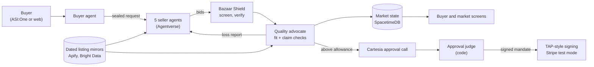

<div align="center">

# Tech Bazaar

### A buyer's agent that is hard to fool and can't pay without you.

Tell it the computer part you need. It reads real store listings, vetoes the traps with a source, blocks listings that try to hijack it, and phones you before it pays more than your allowance.

<p>
  
  
  
  
  
  
</p>

[How it works](#how-it-works) · [For sellers](#for-sellers) · [Real vs simulated](#what-is-real-and-what-is-simulated) · [Results](#measured-results) · [Getting started](#getting-started) · [Architecture](docs/ARCHITECTURE.md)

</div>

<!-- hero screenshot: docs/images/hero.png (coming) -->

## Overview

Tech Bazaar is a buyer's agent for computer gear. You give it a goal, not a one-shot order: this part, under this price, by this date. Three things stand between you and a bad buy:

1. **A quality advocate** checks every offer against the parts you already own and the seller's own page, and vetoes a trap with the source. It is deterministic code; no model decides the veto.
2. **Bazaar Shield**, our agent security API, screens every listing and message before the agent acts on it, and quarantines one that hides instructions or swaps the payee.
3. **A phone call binds the mandate.** Above the allowance you set, nothing is paid until a voice agent calls you, reads the deal, and your one-time code approves that exact, signed deal. Silence, a hang-up or a failed call means nothing is paid.

**It works today without a single outside seller agent.** It reads real, dated store listings (labelled MIRROR) and turns each into a bid, so the protection above runs on real prices now. If no bid comes in, it names the best public listing and buys nothing.

**The reference scenario.** Vidyut needs an RTX 5070 Ti that fits his 305 mm case, under $1,300. Eleven offers arrive in a sealed round: six from real store listings, five from simulated sellers. The cheapest, $757.44, claims "new" while its page says open box, so the advocate vetoes it with the link. Two more are too long for the case (336 mm and 342 mm). The winner is the ASUS Prime RTX 5070 Ti at 304 mm by the maker's spec, $1,299.99 at Best Buy before sales tax (shipping: not captured). That is over Vidyut's $250 allowance, so the agent calls him before it pays.

**The referee is deterministic.** The same offers always rank the same way. Outcomes change only because sellers and their stock change ([docs/ARENA_RULES.md](docs/ARENA_RULES.md)).

**Sellers are how it grows.** Seller agents compete for the buyer within their shop's own prices and policy and learn why they lost. Next, they show the shop which strategy won. See [For sellers](#for-sellers).

## The problem

**Who feels it:** people who upgrade or build a PC. We design first for the upgrader, who already owns a rig and needs one scarce part at a fair price from a seller they can trust. The growth path is small IT buyers (a school, an office, an esports cafe) buying 10 to 50 machines.

- **Prices are wild.** The lowest US listing for an RTX 5070 Ti was $1,119 against a $749 launch price, 49 percent over, on Sep 1, 2026.[^1]
- **Parts must fit each other.** Socket and motherboard, memory generation, power supply wattage and connectors, case and cooler clearance. A part that does not fit is a return and lost days.
- **Cheapest is not always safe.** Open-box parts sold as new, a "was" price that does not match the history, a third-party seller with no record.
- **Shopping agents are easy to fool.** Without defenses, prompt injection succeeded against an AI browser agent 23.6 percent of the time.[^2] In a simulated agent market, buyer agents gave fast sellers a 10x to 30x edge over better ones.[^3]
- **Sellers fly blind.** They cannot see what a buyer asked for, at what ceiling, or why they lost.

We found no sourced number for research time, compatibility mistakes or return rates in PC building, so we claim none.

## How it works

Four steps protect the buyer. A fifth, for sellers, makes the market better over time.

| Step | What happens | Where it lives |
|---|---|---|
| 1. Goal | You state a goal ("this part, under this price, by this date"). The agent skips parts you already own. | `agents/buyer/`, `demo/goal.py` |
| 2. Offers and veto | Offers arrive in a sealed round, today from real, dated store listings (MIRROR) and labelled simulated sellers (SIM). No seller sees your budget or another bid. The advocate checks fit by code (socket, length, wattage) and claims against the page, and vetoes a trap, with the source. | `agents/sellers/`, `agents/advocate/`, `data/fit_checker/` |
| 3. Screen | Shield screens every seller message, listing title and claim before any agent acts on it. An injected listing is quarantined with the rules that fired. | `shield/` |
| 4. Approve by phone | Above your allowance, a Cartesia voice agent phones you, reads the deal from a template filled by code, and answers "why not the cheaper one?". Code, not the voice agent, approves: only the one-time word pair on your screen plus "approve" passes, and it signs one mandate (deal, amount, payee, expiry). | `pay/approval.py`, `pay/voice_cartesia.py`, `pay/mandate.py` |
| 5. Sellers learn | Each losing seller gets a loss report (a banded gap and the reason with its source, never a rival's price) and can adjust its next bid, never below its floor. | `demo/learning.py`, `sim/` |

The referee that ranks offers is deterministic: one ranking rule, ties broken in a fixed order, and the seller fee never enters the ranking.



Components and data flow in detail: [docs/ARCHITECTURE.md](docs/ARCHITECTURE.md).

## Key capabilities

- **A skeptic on the buyer's side.** The advocate is deterministic code, not a model. It can veto the cheapest bid and must cite a source for every warning.
- **Fit checking.** Rules over an open parts dataset plus maker specs; an unknown fit is "uncertain" and can never beat a confirmed fit.
- **Agent security as an API.** Bazaar Shield exposes `POST /v1/shield/screen`, `/verify-agent` and `/verify-mandate`, plus a claim check, with a published rule list. See [shield/API.md](shield/API.md).
- **Voice is the trust step, never the credential.** A recording of your voice cannot approve a payment: the code on your screen is single use, bound to one mandate, and silence, a hang-up or a mismatch all deny.
- **Scoped, replay-proof payments.** Each mandate binds deal, amount, payee, expiry and nonce. A replayed or altered mandate fails.
- **IT purchasing controls.** PO numbers, a requester who cannot approve their own order, three-way match and an audit trail ([hyphenate/](hyphenate/)).

## For sellers

The buyer's protection needs no seller to join. The seller side is how the market grows.

The goal is a seller agent that works like a shop's best salesperson. It looks for real leeway to win a deal (another condition line, a perk, a small price step) and stays inside the shop's own prices and policy. When it loses, it learns why. When a strategy wins, the shop can see it and learn from it too.

What exists today:

- **Seller Kit.** A shop enters its store, pricing, perks and a floor for each condition, and gets a seller agent config and the command to start it ([seller_kit/api.py](seller_kit/api.py), the `/sell` screen, and a Claude conversation path in [docs/SELLER_SKILL.md](docs/SELLER_SKILL.md)). A shop made this way is labelled SIM, because the kit cannot verify a real shop.
- **Floors the referee enforces.** No bid lands below the seller's floor, even from a compromised agent.
- **Loss reports.** Every losing seller gets a banded gap, the reason and its source. It never sees the buyer's cap or a rival's price.
- **A learning step you can inspect.** In the reference run, Gadget Grove (Vedant), a simulated shop, lost round 1 on price by under 5 percent. Its strategy moved its price step from 0 to 3 percent, it bid $1,247.44 open-box against a $1,190 floor, and it won round 2. A control seller that does not learn stayed at $1,329 ([demo/learning.py](demo/learning.py)).
- **A wind tunnel.** Simulated buyers test seller strategies against fixed controls ([sim/](sim/)). It shows no lift we can quote yet (see Measured results).

Planned, not built: richer selling moves (bundles, perks chosen per buyer) and a shop-level view of which strategies won, so a company can reuse what worked.

## What is real and what is simulated

Every bid, claim and screen carries a badge driven by the `source` field in the contracts. Full table: [docs/REAL_VS_SIMULATED.md](docs/REAL_VS_SIMULATED.md). Status as of Oct 24, 2026.

| Component | Label | Notes |
|---|---|---|
| Store listings and prices | MIRROR | Real public listings in dated snapshots ([data/mirror/](data/mirror/)) |
| Seller agents and their bids | SIM | Our agents bid from mirrored listings; no outside shop has bid yet |
| Buyer's goal and owned parts | SIM | Scripted for the reference scenario; the buyer is Vidyut |
| Fit checks, claim checks, Shield | LIVE | Real code on every bid; claim checks run on pages we host for the demo |
| Approval call | LIVE | A real Cartesia phone call to one registered number; silence, a hang-up or a failed call denies, and nothing is paid. The reference runner types the call transcripts and says so |
| Request signing | LIVE | Signed in the style of Visa's Trusted Agent Protocol and verified by our merchant simulator, not by Visa |
| Payment | SIM by default | One Stripe test-mode charge on a Visa test card with `--stripe`; no real money |
| Bright Data | built, env-gated | Re-checks the winner's price only when its key is set; one live call returned the ASUS Prime at $1,299.99 (Sat 02:55). The demo runs without it |
| Tiger Data | built, env-gated | Store and loader for bid curves and market series; connection checked Sat 02:53; not run live in the demo |
| CRS identity and fraud check | built, env-gated | CRS client in `agents/crs.py` and a payee gate in `pay/crs_gate.py`; not run live in the demo, and nothing calls the gate before the charge yet |
| Wind tunnel buyers | SIM | Simulated by design |

## Measured results

Every number comes from [data/scoreboard.json](data/scoreboard.json), regenerated by `python3 -m data.scoreboard`. Headlines are first runs; anything fixed after reading a result is marked as no longer blind. All runs are dated 2026-10-24.

| Measure | Result | Reproduce |
|---|---|---|
| Shield, held-out attacks | 12 of 20 stopped; 2 of 10 honest listings wrongly blocked | `python3 -m shield.bench` |
| Fit checker | 39 of 39 right on maker-checked builds; 48 of 49 on all; 0 false OK (tuned set, not held out) | `python3 -m data.fit_checker.eval_builds` |
| Voice approval attacks | 9 of 10 denied on the first run (10 of 10 after one fix, not blind) | `python3 -m pytest pay/tests/test_voice_attacks.py -q` |
| Purchasing controls, blind planted errors | 26 of 27 caught on the first run; 2 of 7 clean cases falsely flagged | `python3 -m hyphenate.scenarios.blind_run --write` |
| Seller learning lift | No lift to quote: the learner beats the control on 1 of 4 held-out buyer types | `python3 -m sim.wind_tunnel --builders 48 --seeds 3` |
| Verified savings | None yet: the price reference is ready (7 retail asks from 2 providers), but no verified purchase is recorded | `python3 -m data.baselines` |

Shield on its development set stops 30 of 30, but its rules were written against that set, so we never pool it with the held-out result and never call Shield "secure."

## Built with

| Partner | What we use | Role in Tech Bazaar |
|---|---|---|
| Fetch.ai | uAgents, Agentverse, ASI:One, Agent Chat Protocol, Payment Protocol | Every agent is a registered uAgent; the buyer takes goals in ASI:One |
| Visa | Trusted Agent Protocol (style), Visa test card | Signed agent requests; the test card behind the Stripe charge |
| Stripe | Test mode | The one sandbox charge, idempotent on the mandate hash |
| Cartesia | Voice agent, outbound calls | The approval call |
| Apify | Store actors, our own [claim-check Actor](https://apify.com/anoopibrampur/tech-bazaar-claim-check) | Listing mirrors and claim checks |
| Bright Data | Scraper API | A second, dated price source (built, env-gated) |
| Tiger Data | Time-series Postgres | Savings and seller trends over time (built, env-gated) |
| CRS | Credit API sandbox | Business seller identity and fraud check (built, env-gated) |
| SpacetimeDB | Reducers and live state | Auction state; floor prices and approval-before-payment enforced in reducers |
| Anthropic | Claude | Optional seller persona lines and an off-by-default Shield classifier (`shield/classifier.py`) |

Public data: the CPSC recalls API and [docyx/pc-part-dataset](https://github.com/docyx/pc-part-dataset) (MIT) for compatibility fields.

## Fetch.ai agents

| Agent name | Role | Agentverse address |
|---|---|---|
| Tech Bazaar Buyer (@techbazaarbuyer) | Takes goals over the Chat Protocol, remembers owned parts, runs the sealed round, pays within the allowance | `agent1qwxhy93uzmw5prlqldm8a2mz9gsmc2563um6th2l6z0pudw63juej97nmj8` |
| Tech Bazaar Quality Advocate (@techbazaaradvocate) | Checks fit and claims; at most 3 cited warnings; can veto the cheapest bid; never sees the fee | `agent1qvxvlletez0ywdcq7da76ufzz4lvh5xvtd4fxam22g6phqzr07kvjcmhv05` |
| Tech Bazaar Shield Client (@techbazaarshield) | Chat front door to Shield screening; makes no purchases | `agent1q0m2z43cf3hg4cfy87hatf69ulyqkvuylm6mjv53e6y05weqmhjj6k4lknp` |
| Byte Bros Outlet (@techbazaarseller1) | Seller agent: bids from its listings, never below its floor | `agent1qd3gvg54tsaezed0wzpgg34rza4y6kvvfd778nj6h27j20k99d38zd3et9m` |
| Silicon Sally's Surplus (@techbazaarseller2) | Seller agent | `agent1qw9dvuwgnh570wyk8uukp0w48a03tdpmtuv8csm3qxy6t3udl3ahs2264np` |
| FlashDeal Frankie (@techbazaarseller3) | Seller agent; carries the planted condition trap (SIM) | `agent1qdcrmqy2ra2tvshq2qhc8q5rvqzpr7du77st32qynwazy48gtuvyspdm26l` |
| Bay Area PC Shop | Seller agent: fixed margin | *pending* |
| ReNew Refurb | Seller agent: refurbished and open-box lines | *pending* |

Registration details and profile checks: [agents/README.md](agents/README.md).

## Getting started

**Prerequisites:** Python 3.12, Node.js with npm, the SpacetimeDB CLI, and sandbox keys for the services you want live (names in [.env.example](.env.example)). The launcher tells you what is missing.

```bash
git clone https://github.com/vs-githjk/cal-hacks-2026.git tech-bazaar && cd tech-bazaar
cp .env.example .env                                  # your own sandbox keys; .env is gitignored
python3 scripts/launch.py up --env-file .env          # preflight, then start every service that can start
python3 scripts/launch.py status                      # service, port, pid, health
python3 scripts/launch.py down                        # stop only what it started
```

`up` prints one OK or MISSING line per prerequisite with its fix, then starts SpacetimeDB, Shield (8787), the seller, advocate and buyer agents, and the web app (3100). A service without its prerequisites shows as SKIPPED, never as up. Nothing is installed globally.

<details>
<summary>Run the reference scenario and the tests</summary>

```bash
python3 demo/run_demo.py              # all five steps; writes demo/out/run-<timestamp>.json
python3 demo/run_demo.py --stripe     # adds one Stripe test-mode charge (needs an sk_test_ key)
python3 -m pytest -q --ignore=agents  # Python tests
agents/.venv/bin/python -m pytest -q agents
```

More: [demo/README.md](demo/README.md), [pay/README.md](pay/README.md), [shield/API.md](shield/API.md).
</details>

## Repository structure

```
agents/      Fetch.ai uAgents: buyer, quality advocate, sellers, Shield client, Payment Protocol
contracts/   Shared JSON schemas (Goal, Bid, ShieldVerdict, Mandate, LossReport, ...)
data/        Listing mirrors, fit checker, claim checks, baselines, scoreboard
demo/        The reference scenario and stage runner
hyphenate/   IT purchasing controls and blind test scenarios
market/      SpacetimeDB module and auction rules (sealing, scoring, outcomes)
pay/         Approval judge, mandates, request signing, merchant simulator, Cartesia call client
shield/      Bazaar Shield API, rules, attack corpus and bench
sim/         Wind tunnel: simulated buyers and hostile agents
web/         Next.js buyer and market screens
docs/        Architecture, real vs simulated, red team, research notes
```

## Safety and design invariants

These live in code and tests, not in prompts.

1. **No payment without a limit check and an approval** for the same mandate hash. No answer means no payment.
2. **No agent acts on another agent's text before Shield screens it.** Screening fails closed for payments.
3. **No seller bids below its floor,** enforced in market reducers, so even a compromised agent cannot.
4. **Sealed bids.** Sellers never see your budget, your allowance or each other's bids.
5. **Scoped mandates:** one seller, an amount cap, an expiry, single use and an idempotency key.
6. **The agent never re-buys a part you own** unless you ask.
7. **Sandbox only:** test cards and test identities, no real money, no secrets in the repository.
8. **Anything simulated is labelled** on screen and in this README.

## Roadmap

- Outside sellers bidding live through the Seller Kit and an open seller protocol.
- Seller agents that sell better within their shop's policy, and a shop-level report of the strategies that won.
- Bright Data price re-check live before every approval call, and Tiger Data savings curves.
- CRS identity and fraud gate on business sellers before the charge, sharing only a band.
- Small IT buyers (10 to 50 machines), where sealed volume bids matter most.
- Visa Intelligent Commerce tokens in place of the Stripe path, given sandbox access.
- Tech Bazaar as an MCP server, so any agent can request bids.

## Team

Vidyut Sriram, Vedant Shirvi, Abhinav, Anoop Ibrampur.

## License

Tech Bazaar is released under the [MIT License](LICENSE). Copyright (c) 2026 the Tech Bazaar team.

Third-party data keeps its own license, including [docyx/pc-part-dataset](https://github.com/docyx/pc-part-dataset) (MIT). Product and retailer names belong to their owners and are shown for price comparison only.

[^1]: Capital & Compute, [NVIDIA GPU prices](https://capitalandcompute.net/gpu-prices/nvidia/), citing Tom's Hardware, Sep 1, 2026.
[^2]: Anthropic, [Piloting Claude for Chrome](https://www.anthropic.com/news/claude-for-chrome), Aug 25, 2025: 23.6 percent attack success without mitigations, 11.2 percent with them.
[^3]: Microsoft Research, [Magentic Marketplace](https://arxiv.org/abs/2510.25779), arXiv 2510.25779, Oct 2025.
