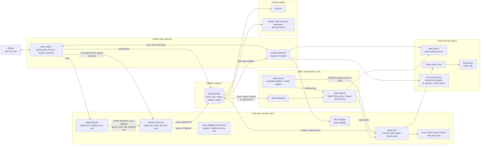
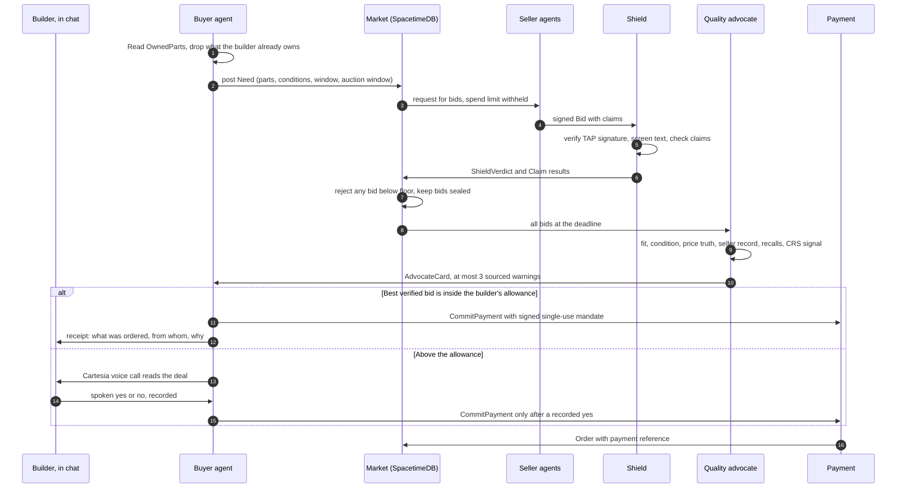

# Tech Bazaar architecture

This is the design we are building at Cal Hacks 13.0. What is built so far is tracked in the README's [Status](../README.md#status) table; what is real versus simulated is in [REAL_VS_SIMULATED.md](REAL_VS_SIMULATED.md).

## System diagram

## One order, step by step

## Components

| Component | Folder | Lane | What it does |
|---|---|---|---|
| Buyer agent | `agents/` | A | uAgent with the Agent Chat Protocol, reachable in ASI:One. Keeps `OwnedPart` memory (never re-buys what the builder owns, cites the entry), posts a `Need`, collects bids, pays through the Payment Protocol after the approval gate. |
| Quality advocate | `agents/` | A | Claude-based agent that builds an `AdvocateCard` per bid: fit (from Lane C's rules engine, never decided by the model), condition, price truth against history, seller record, CPSC recalls, CRS stability signal. Drops any warning its evidence does not support; caps warnings at three. |
| Seller agents and gateway | `agents/` | A | Each seller agent prices from policy code (floor, discount curve, perks) over Apify-mirrored prices; demo sellers are marketplace or used sellers or SIM sellers built from real listings. The language model only writes the persona's line. About six agents register on Agentverse; the rest run as a labelled fleet behind the gateway. |
| Market | `market/` | B | SpacetimeDB module holding needs, bids, claims, verdicts and orders. Reducers enforce the floor price, sealed bids and approval before payment. Convex is the fallback if SpacetimeDB blocks us. |
| Screens | `web/` | B | Next.js builder view, voice approval screen and seller dashboard (demand trends), plus the three.js 3D floor. Every character and motion comes from a market row. |
| Data and truth | `data/` | C | Apify actors mirror seller catalogs with a snapshot id and date. Our claim-check Actor returns verified, unverified or false with evidence. Bright Data covers the wider web. A fit checker (docyx/pc-part-dataset plus two small tables) decides compatibility in code. CPSC recalls and a used-price baseline feed the advocate. Demand and trend series feed the seller dashboard. |
| Shield | `shield/` | D | FastAPI service. `/screen` checks agent messages for planted instructions, scam patterns and mandate mismatches (payee or amount differs from the approved need). `/verify-agent` consumes Trusted Agent Protocol signatures. `/check-claim` calls the claim checker. Also flags near-identical bids across sellers. |
| Payments and identity | `pay/` | D | Approval gate (allowance, Cartesia voice call, recorded yes before payment). Trusted Agent Protocol signing on every agent request to a seller. Stripe test-mode charge on a Visa test card through the Payment Protocol. Visa Intelligent Commerce adapter behind the same interface. CRS adapter that returns only a `SupplierSignal` (seller stability). |
| Wind tunnel | `sim/` | D | Simulated builders, honest and hostile, run against a seller's agent. Reports conversion, margin kept and attacks that landed. Every hostile message becomes a Shield test case. |

## Contracts

All lanes talk through the JSON schemas in [`contracts/`](../contracts/). Changes need a line in [CHANGES.md](CHANGES.md).

| Contract | Carries |
|---|---|
| `OwnedPart` | A part the builder owns or bought (proposed, Lane A) |
| `DemandRecord`, `TrendSignal` | Anonymized demand and its trend, seller side (proposed rename of `UsageRecord` and `Forecast`) |
| `Allowance`, `VoiceApproval` | Auto-approve limit, and the recorded voice answer before payment (proposed, Lane D) |
| `Need` | Parts with condition and variant, delivery window, spend limit, consent, auction window |
| `Bid` | Lines, total landed price, perks, claims, floor check result, mirror snapshot id, decision trace, expiry |
| `Claim` | One seller claim and its check result with evidence |
| `ShieldVerdict` | Allow, quarantine or block, with reasons and attack type |
| `SupplierSignal` | `verified_stable`, `caution` or `not_verified`, with the check time |
| `AdvocateCard` | Warnings with sources and a recommendation |
| `Order` | Amount, approval, limit check, idempotency key, payment reference, status |
| `LedgerEntry` | Double-entry lines for the seller finance desk (stretch, Open decision 2) |
| `Persona` | A seller character's name, archetype, voice and model |
| `FloorEvent` | What the 3D floor animates, always traced to a market row |

Every record that can be real or not carries a `source` field (`live`, `mirror`, `simulated`, `sandbox`, `recorded`). The UI turns it into the LIVE, MIRROR, SIM, SANDBOX or RECORDED badge.

## Trust boundaries

- **Builder to seller.** Sellers receive parts, conditions and the delivery window. The spend limit, the allowance, the owned-parts memory and other bids never cross. Sellers never see an individual builder; the seller dashboard shows aggregates only, with a minimum group size.
- **Seller to builder.** Every seller message passes Shield before any agent reads it. Claims are checked against a page, not taken on trust.
- **CRS.** Credit and loan data stay inside the CRS check. Only the `SupplierSignal` leaves it.
- **Money.** A payment needs a signed mandate with an amount cap, one seller, an expiry and single use. A payment above the builder's allowance also needs the recorded voice yes (or the review card). Shield fails closed on payments: if screening times out, nothing is paid.

## Staying up during a live demo

The plan is for each external adapter (Apify, Bright Data, CPSC, CRS, Claude, Cartesia, Visa, Stripe) to run in one of three modes: live, cached or replay. Calls time out after 4 to 6 seconds and fall back to a committed, dated snapshot, and the footer shows which mode each service is in, so a fallback is never silent. Each service exposes `/health`, and a labelled recorded run of the full path is the last resort.
